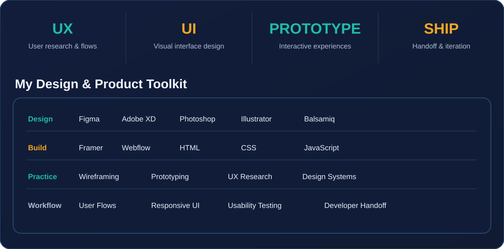

 

  

## Featured Projects

- **BUNO Banking App** — Mobile banking concept covering onboarding, card applications and payment experiences.
- **TerraTech Maintenance App** — Maintenance workflow experience for employees, supervisors and administrators.
- **Akira Service Tool** — Service ticketing workflow with assignment, escalation and SLA tracking.

---

  Product Designer · UI/UX · Digital Experiences

