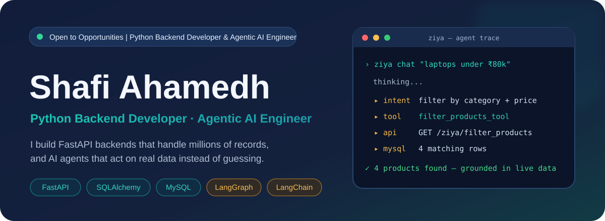

 

---

> **Important:** This template intentionally follows the reference profile's wording and technology labels. Keep the backend/AI claims only if they accurately describe your skills and work. Replace the placeholder links before publishing.

## About

I build FastAPI backends that handle millions of records, and AI agents that act on real data instead of guessing.

## Tech Stack

  
  
  
  
  

## Featured Projects

Add your project repositories here:

- **Project 1** — Replace with your project name and a one-line description.
- **Project 2** — Replace with your project name and a one-line description.
- **Project 3** — Replace with your project name and a one-line description.

## GitHub Activity

  
   
  

---

  Thanks for visiting my profile.

