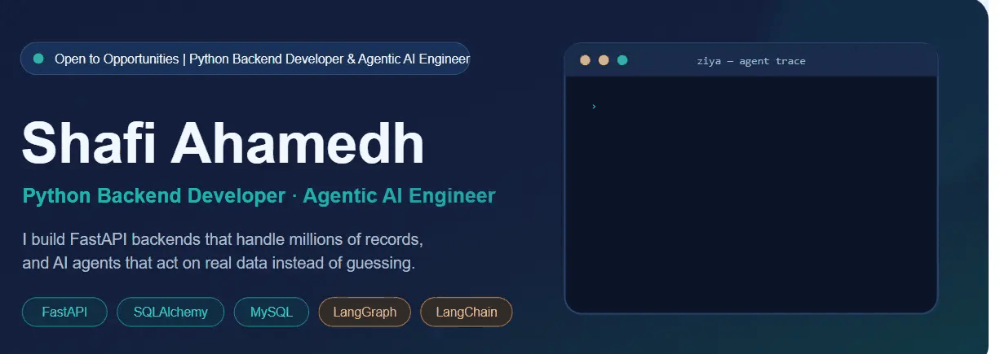

 

---

> Note: The animated terminal is a visual typing simulation. Replace the portfolio, LinkedIn and resume placeholders with your real links. Keep the backend/AI role claims and technology labels only if they accurately describe your skills and experience.

## Tech Stack

FastAPI · SQLAlchemy · MySQL · LangGraph · LangChain

## Featured Projects

- **Project 1** — Add your project name and description.
- **Project 2** — Add your project name and description.
- **Project 3** — Add your project name and description.

## GitHub Activity

  
   
  

